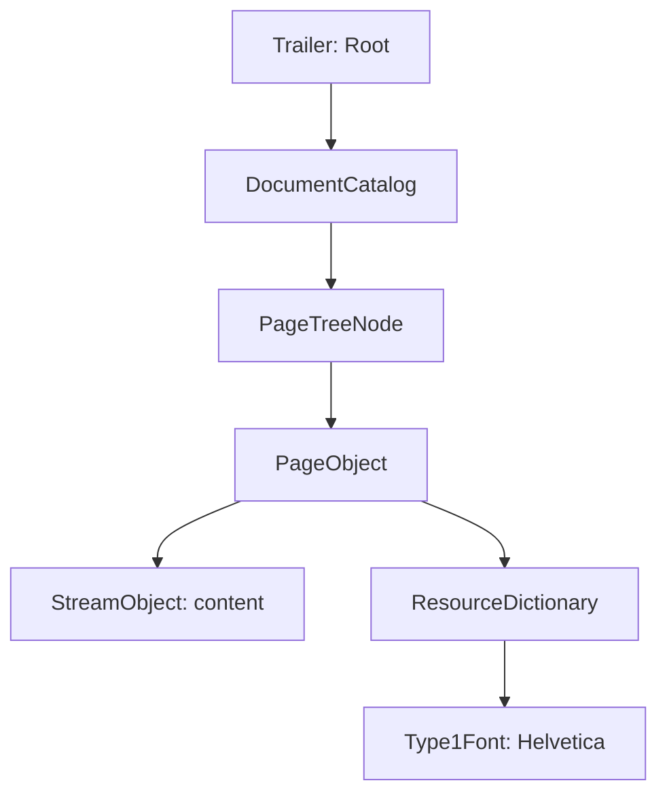

# 01. A first document

This lesson builds a page containing a sentence and a document title. It explains the minimum set of objects that lets a PDF reader find the page, its font and its content.

**Prerequisite:** install the dependencies as described in the [index](README.md). No prior knowledge of PDF syntax is required.

## Run the example

From the root of a core checkout:

```sh
php examples/hello-world.php
```

Open `examples/hello-world.pdf`. The Letter-sized page displays “Super ! Le PDF est construit objet par objet.” The title “Un PDF entièrement objet” is metadata; depending on the reader, it appears in the document properties.


The [complete code](https://github.com/PDFToolkit/pdf/blob/v0.11.0/examples/hello-world.php) contains the imports and comments corresponding to the steps below.

## 1. Name a font resource

`Type1Font(StandardFont::Helvetica)` creates the dictionary for the standard Helvetica font. The resources' `/Font` dictionary associates this instance with the local name `/F1`:

```php
$helvetica = new Type1Font(StandardFont::Helvetica);
$resources = new ResourceDictionary(
    new Font(new DictionaryType(
        new Entry(new NameType('F1'), new IndirectReference($helvetica)),
    )),
);
```

Here, `Font` is the `/Font` entry in the resource dictionary. `/F1` is a name chosen for this document; it can change if the operator selecting the font uses the same name. `/Helvetica` identifies the font itself. The standard font is not embedded: the reader supplies its representation.

An `IndirectReference` targets the PHP object. Objects can therefore be linked before their numbers in the PDF are known.

## 2. Describe text with instructions

Page content is a sequence of operators. Their PHP names describe the instructions; their tokens belong to the file format:

| Object | Generated syntax | Effect in this example |
| --- | --- | --- |
| `BeginTextObject` | `BT` | Start the text object and initialize its matrices. |
| `SetTextFontAndSize` | `/F1 18 Tf` | Select resource `/F1` and a size of 18. |
| `MoveTextPosition` | `72 720 Td` | Move the text origin from the initial matrices. |
| `ShowText` | `(Super ! …) Tj` | Display the glyphs corresponding to the string's bytes. |
| `EndTextObject` | `ET` | End the text object. |

In this page's default user space, one unit is 1/72 inch. Position `(72, 720)` is one inch from the left edge and one inch below the top of the page, whose height is 792. The vertical axis increases upwards.

`ContentStreams` holds the instructions and checks their context. `StreamObject` wraps their representation in an actual PDF stream. The writer will calculate `/Length` from its bytes.

The displayed text is ASCII. `LiteralString` does not convert fonts or encodings: putting arbitrary UTF-8 text in `Tj` is not enough to display Unicode characters. The document title instead uses `TextString`, which is suitable for textual metadata strings.

## 3. Link content, page and catalog

The `Rectangle` built from four `NumericType` values defines `/MediaBox`: `[0 0 612 792]`, the area of a Letter-sized page. `PageObject` links this rectangle, the resources and the content stream. `PageTreeNode::addKid()` attaches the page to the tree and establishes ownership.



The tree produces `/Kids`, `/Count` and the `/Parent` references. `DocumentCatalog` contains `/Type /Catalog` and a `/Pages` reference to the tree's root. A page cannot belong to two parents.

## 4. Add information and write

`DocumentInformation` contains the `/Title` entry. An `/Info` entry in the trailer additions references this dictionary. The script also explicitly supplies the `/Root` reference to the catalog; examples that place the catalog directly in `FileBody` can let the writer determine it.

`FileStructure` assembles the PDF 1.7 header, the body and these references. `writeTo()` traverses the objects, assigns their numbers, writes the streams and produces the cross-reference table using actual offsets. Each write has its own identity context.

## Change it to understand it

- Replace 18 with 24 to increase the font size.
- Replace position `(72, 720)` with `(72, 100)` to move the sentence towards the bottom of the page.
- Replace `/F1` with `/TitleFont` in the resources **and** in `SetTextFontAndSize` to keep the same rendering.
- Change the title's `TextString` to update document properties without changing the sentence printed on the page.

This script does not wrap lines or calculate margins automatically. The [next tutorial](02-pages-and-text.md) explicitly demonstrates lines and the assembly of several pages.

**In the specification:** objects and references (§7.3), file structure (§7.5), catalog and page tree (§7.7.2–7.7.3), resources (§7.8.3), coordinate spaces (§8.3.2), text (§9.3–9.4), document information (§14.3.3).

[Tutorial index](README.md) · [Next: pages and text](02-pages-and-text.md)
