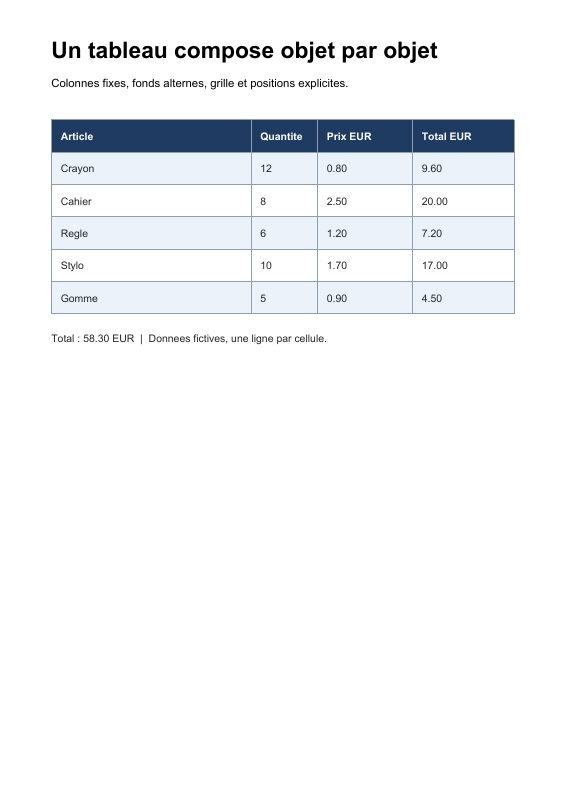

# Recette : un tableau dessiné explicitement

[Exemples pratiques](README.md) · [Parcours des tutoriels](../tutorials/README.md)

## But et prérequis

Dessiner un petit tableau de cinq articles avec un en-tête sombre, des lignes alternées, une grille et deux polices. La mise en page demeure dans [examples/table.php](../../examples/table.php) : le noyau reçoit des objets d'opérateurs PDF.

Lire les tutoriels [pages et texte](../tutorials/02-pages-and-text.md) et [graphiques](../tutorials/03-graphics.md). Installer les dépendances avec `composer install`, puis utiliser PHP 8.3 ou supérieur et les extensions demandées par Composer.

## Exécuter et regarder

Depuis la racine du dépôt :

```sh
php examples/table.php
php examples/table.php table-demo.pdf
```

Le premier appel produit `examples/table.pdf`. Le résultat tient sur une page, avec quatre colonnes et une ligne de total sous la grille. Les données sont fictives ; les valeurs monétaires sont des chaînes de démonstration déjà préparées.



## Ce que construit le script

La page est large de 595 unités et haute de 842. La table commence à `x = 54`, `y = 716`, mesure 487 unités de largeur et comporte six lignes de 34 unités, en comptant l'en-tête. Le bas est donc `716 - 6 × 34 = 512`. Avec les réglages de page de cet exemple, une unité vaut 1/72 de pouce ; les valeurs ressemblent à des points typographiques.

| Étape | Objets utilisés | Pourquoi |
| --- | --- | --- |
| Données et géométrie | Tableaux PHP, largeurs et hauteur de ligne | Calculer le dessin propre à cet exemple |
| Ressources | Deux `Type1Font`, une entrée `/Font` | Choisir Helvetica et Helvetica-Bold avec `/F1` et `/F2` |
| Fonds | `SetNonstrokingRGBColor`, `AppendRectangle`, `FillPathNonzero` | Remplir l'en-tête et les lignes alternées |
| Grille | `SetStrokingRGBColor`, `SetLineWidth`, `MoveTo`, `LineTo`, `StrokePath` | Construire tous les segments, puis les tracer |
| Cellules | `BeginTextObject`, `SetTextFontAndSize`, `MoveTextPosition`, `ShowText`, `EndTextObject` | Placer explicitement chaque ligne de texte |
| Fichier | `ContentStreams`, `StreamObject`, `PageObject`, `DocumentCatalog`, `FileStructure` | Transformer les instructions en un document PDF |

Les listes PHP aident à calculer les répétitions. Les instructions résultantes restent des objets : chaque nombre est un `NumericType`, chaque nom de ressource un `NameType`, chaque chaîne un `LiteralString`.

## Couleur, chemins et texte

`rg` règle la couleur de remplissage, utilisée aussi pour les glyphes. L'en-tête reçoit d'abord un fond sombre ; son texte reçoit ensuite un remplissage blanc. `RG` règle la couleur des contours, ici celle de la grille. Changer la couleur ne dessine encore rien.

`AppendRectangle` correspond à `re` : ses paramètres sont **x, y, largeur, hauteur**. Après chaque rectangle de fond, `FillPathNonzero` (`f`) remplit puis termine le chemin. Les segments de grille peuvent partager un même chemin : chaque `MoveTo` (`m`) démarre un sous-chemin, chaque `LineTo` (`l`) ajoute un segment, et le `StrokePath` (`S`) final les trace.

Pour les cellules, `y` diminue lorsqu'on descend dans la table. Le décalage horizontal de 10 est la marge intérieure choisie. Le décalage vertical de 22 place la **ligne de base** du texte ; ce n'est pas une mesure de hauteur de glyphe. Chaque cellule ouvre son propre `BT`/`ET`, donc son `Td` repart de la matrice texte identité au lieu de cumuler les déplacements des cellules précédentes.

## Correspondance avec ISO 32000-1:2008

| Concept | Référence |
| --- | --- |
| Repères et unités | §8.3.2 |
| Largeur des traits | §8.4.3.2 |
| Construction et tracé de chemins | §8.5.2 et §8.5.3 |
| Opérateurs de couleur | §8.6.8 |
| Polices Type 1 et polices standard | §9.6.2 |
| États et positionnement du texte | §9.3 et §9.4 |

Le mot « tableau » désigne ici le résultat visuel. Un tableau sémantique et accessible implique une structure logique PDF supplémentaire (§14.7), que cette recette ne construit pas. La [norme du dépôt](../../PDF32000_2008.pdf) et le [guide d'architecture](../architecture.md) donnent le cadre de ces objets.

## Adapter la recette

Ajouter une ligne dans `$rows` prolonge la grille et déplace la note finale. Adapter `$columnWidths` déplace les séparateurs et les origines des cellules. `$rowHeight` change à la fois les fonds, la grille et les lignes de base ; revoir le décalage de texte si la hauteur devient trop petite. Modifier les triples RGB, dont les composantes ici sont comprises entre 0 et 1, change la palette.

La recette suppose que toutes les valeurs tiennent sur une ligne et une page. Elle ne mesure pas les glyphes, ne calcule pas les montants, n'aligne pas les décimales, n'applique pas de césure et ne déclenche pas de saut de page. Une bibliothèque de mise en page pourra calculer ces décisions avant de produire les mêmes objets du noyau.

[Retour aux exemples pratiques](README.md) · [Revoir les opérateurs graphiques](../tutorials/03-graphics.md)
