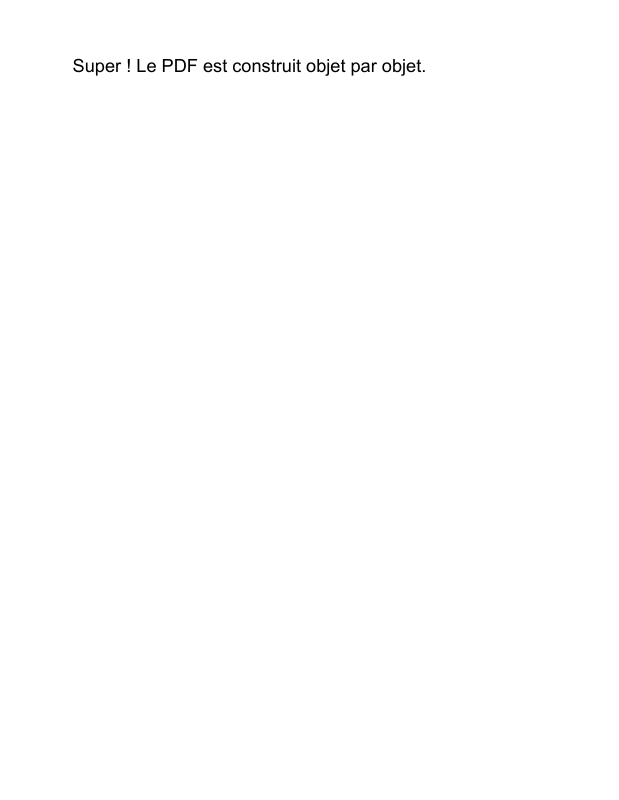
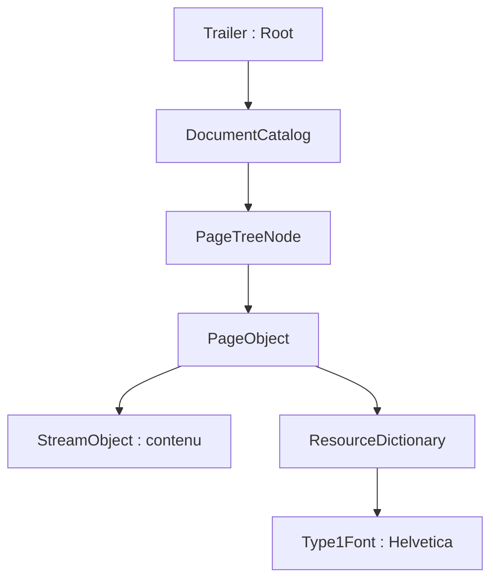

# 01. Un premier document

Cette leçon construit une page contenant une phrase et un titre documentaire. Elle explique les objets minimums qui permettent à un lecteur PDF de trouver la page, sa police et son contenu.

**Prérequis :** avoir installé les dépendances comme indiqué dans [l'index](README.md). Aucune connaissance préalable de la syntaxe PDF n'est nécessaire.

## Exécuter l'exemple

Depuis la racine du dépôt :

```sh
php examples/hello-world.php
```

Ouvrir `examples/hello-world.pdf`. La page au format Letter porte la phrase « Super ! Le PDF est construit objet par objet. ». Le titre « Un PDF entièrement objet » est une métadonnée ; il apparaît dans les propriétés du document selon le lecteur.



Le [code complet](../../examples/hello-world.php) contient les imports et les commentaires qui correspondent aux étapes ci-dessous.

## 1. Donner un nom à une ressource de police

`Type1Font(StandardFont::Helvetica)` crée le dictionnaire de la police standard Helvetica. Le dictionnaire `/Font` des ressources associe cette instance au nom local `/F1` :

```php
$helvetica = new Type1Font(StandardFont::Helvetica);
$resources = new ResourceDictionary(
    new Font(new DictionaryType(
        new Entry(new NameType('F1'), new IndirectReference($helvetica)),
    )),
);
```

`Font` est ici l'entrée `/Font` du dictionnaire de ressources. `/F1` est un nom choisi pour ce document ; il peut changer si l'opérateur qui sélectionne la police utilise le même nom. `/Helvetica` identifie la police elle-même. La police standard n'est pas incorporée : le lecteur fournit sa représentation.

Une `IndirectReference` vise l'objet PHP. Il est donc possible de relier les objets avant de connaître leur numéro dans le PDF.

## 2. Décrire le texte par des instructions

Le contenu de page est une suite d'opérateurs. Leur nom PHP décrit l'instruction ; leur token est celui du format :

| Objet | Syntaxe produite | Effet dans cet exemple |
| --- | --- | --- |
| `BeginTextObject` | `BT` | Commencer l'objet texte et initialiser ses matrices. |
| `SetTextFontAndSize` | `/F1 18 Tf` | Sélectionner la ressource `/F1` et une taille de 18. |
| `MoveTextPosition` | `72 720 Td` | Déplacer l'origine du texte depuis les matrices initiales. |
| `ShowText` | `(Super ! …) Tj` | Afficher les glyphes correspondant aux octets de la chaîne. |
| `EndTextObject` | `ET` | Terminer l'objet texte. |

Dans l'espace utilisateur par défaut de cette page, une unité vaut 1/72 de pouce. La position `(72, 720)` se situe à un pouce du bord gauche et à un pouce sous le haut de la page, dont la hauteur est 792. L'axe vertical augmente vers le haut.

`ContentStreams` contient les instructions et contrôle leur contexte. `StreamObject` enveloppe leur représentation dans un véritable flux PDF. Le writer calculera `/Length` à partir de ses octets.

Le texte affiché est ASCII. `LiteralString` n'effectue pas de conversion de police ou d'encodage : insérer du texte UTF-8 arbitraire dans `Tj` ne suffit pas à afficher des caractères Unicode. En revanche, le titre documentaire utilise `TextString`, adapté aux chaînes textuelles des métadonnées.

## 3. Relier contenu, page et catalogue

Le `Rectangle` construit avec quatre `NumericType` définit `/MediaBox` : `[0 0 612 792]`, la surface de la page au format Letter. `PageObject` relie ce rectangle, les ressources et le flux de contenu. `PageTreeNode::addKid()` attache la page à l'arbre et établit sa propriété.



L'arbre produit `/Kids`, `/Count` et les références `/Parent`. Le `DocumentCatalog` contient `/Type /Catalog` et une référence `/Pages` vers la racine de cet arbre. Une page ne peut pas appartenir à deux parents.

## 4. Ajouter les informations et écrire

`DocumentInformation` contient l'entrée `/Title`. Une entrée `/Info` dans les ajouts du trailer référence ce dictionnaire. Le script fournit aussi explicitement la référence `/Root` vers le catalogue ; les exemples qui placent le catalogue directement dans `FileBody` peuvent laisser le writer la déterminer.

`FileStructure` assemble le header PDF 1.7, le corps et ces références. `writeTo()` parcourt les objets, attribue leurs numéros, écrit les flux et produit la table de références croisées avec les offsets réels. Chaque écriture dispose de son propre contexte d'identité.

## Modifier pour comprendre

- Remplacer 18 par 24 augmente la taille de la police.
- Remplacer la position `(72, 720)` par `(72, 100)` descend la phrase vers le bas de la page.
- Remplacer `/F1` par `/TitleFont` dans les ressources **et** dans `SetTextFontAndSize` conserve le même rendu.
- Modifier le `TextString` du titre change les propriétés du document, sans changer la phrase imprimée sur la page.

Ce script ne réalise pas de retour à la ligne ni de calcul de marge automatique. Le [tutoriel suivant](02-pages-and-text.md) montre explicitement les lignes et l'assemblage de plusieurs pages.

**Dans la norme :** objets et références (§7.3), structure du fichier (§7.5), catalogue et arbre de pages (§7.7.2-7.7.3), ressources (§7.8.3), espaces de coordonnées (§8.3.2), texte (§9.3-9.4), informations documentaires (§14.3.3).

[Index des tutoriels](README.md) · [Suivant : pages et texte](02-pages-and-text.md)
