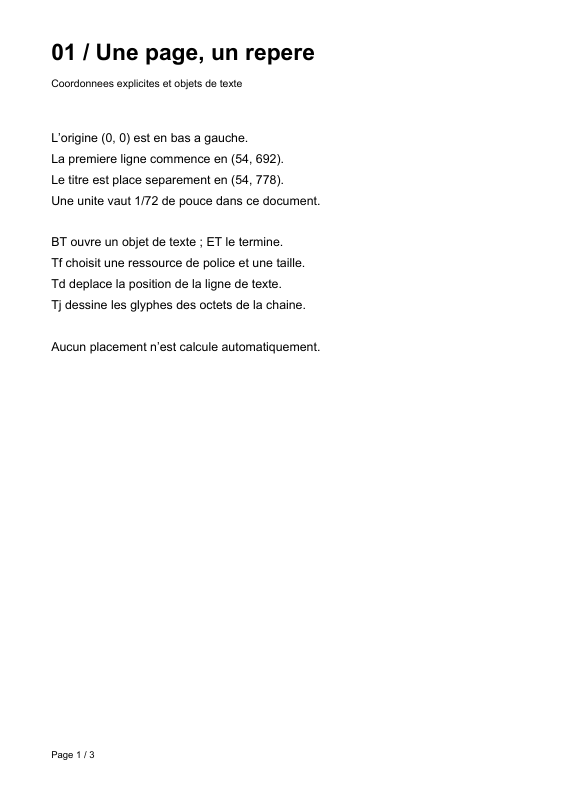

# 02. Plusieurs pages et placement du texte

[Index des tutoriels](README.md) · [Précédent : premier document](01-first-document.md) · [Suivant : tracés et couleurs](03-graphics.md)

Cette leçon construit trois pages A4 qui partagent leurs ressources. Elle montre comment placer du texte, choisir un interligne et composer un pied de page. Le script complet est [pages-and-text.php](../../examples/pages-and-text.php).

## Exécuter l'exemple

Utiliser PHP 8.3 ou supérieur et les dépendances installées par `composer install`, comme dans le [premier tutoriel](01-first-document.md). Depuis la racine du dépôt :

```sh
php examples/pages-and-text.php pages-and-text.pdf
```

Le premier argument désigne le fichier de sortie. Sans argument, le script écrit dans `examples/pages-and-text.pdf`. Son répertoire parent doit déjà exister.

## Ce que l'on obtient

Trois pages A4, chacune avec un titre, un sous-titre, plusieurs lignes de texte et un numéro de page. Le corps utilise une taille de 13 unités et un interligne de 22 unités. Les chaînes affichées sont volontairement en ASCII ; le titre du document dans les métadonnées contient des accents.



## 1. Partager les ressources et le papier

Les deux instances de `Type1Font` représentent Helvetica et Helvetica-Bold. Le dictionnaire `Font` des ressources associe ces objets aux noms `/F1` et `/F2`. Un `SetTextFontAndSize` vise ce nom local : `/F1` n'est pas le nom commercial de la police.

Le `PageTreeNode` reçoit les entrées `/MediaBox` et `/Resources`. Les trois `PageObject` fournissent uniquement leur flux `/Contents`. Lorsqu'une page n'a pas de valeur locale pour une entrée héritable, le lecteur PDF remonte l'arbre `/Pages` : il retrouve ici le même rectangle et les mêmes ressources.

```php
$page = new PageObject(contents: new StreamObject($contents));
$pages->addKid($page);
```

Les noms `/Kids`, `/Parent` et `/Count` sont produits par le modèle d'arbre. Chaque page appartient à un seul parent. Les références vers les polices et les ressources visent les mêmes instances ; le sérialiseur attribue un seul numéro d'objet à chacune.

Référence : ISO 32000-1, **7.7.3** pour l'arbre des pages et les attributs héritables, **7.8.3** pour les dictionnaires de ressources, **9.6.2.2** pour les quatorze polices standard.

## 2. Comprendre les coordonnées

La `/MediaBox` est `[0 0 595.28 841.89]`. Dans ce document, une unité de l'espace utilisateur vaut **1/72 de pouce**. Le rectangle représente donc approximativement un A4 de 210 × 297 mm.

L'origine est en bas à gauche. La position `(54, 778)` place le titre près du bord supérieur. Augmenter `y` fait monter le texte dans cette page, qui n'a ni rotation ni transformation initiale supplémentaire.

`BeginTextObject` (`BT`) initialise les matrices de texte à l'identité. Le premier `MoveTextPosition` (`Td`) déplace la matrice de ligne de texte de `(54, 692)`. Dans cet état initial, la position est donc directement celle de la page. Un autre `Td` dans le même objet serait un déplacement relatif dans le repère de la ligne, et non une nouvelle coordonnée absolue sur le papier.

Référence : **8.3.2.3** pour l'espace utilisateur, **9.4.1–9.4.2** pour les objets et le placement du texte.

## 3. Descendre d'une ligne

Le corps est un objet de texte unique : `BT`, choix de police, choix d'interligne, placement initial, plusieurs instructions d'affichage, puis `ET`.

| Objet | Opérateur | Effet dans cet exemple |
| --- | --- | --- |
| `SetTextFontAndSize` | `Tf` | Choisit `/F1` à la taille 13. |
| `SetTextLeading` | `TL` | Fixe un interligne de 22 unités. |
| `MoveToNextTextLine` | `T*` | Revient au début de ligne et descend de 22 unités. |
| `ShowText` | `Tj` | Dessine les glyphes de la chaîne. |

Chaque ligne est ajoutée avec `ContentStreams::with()`. La séquence est immuable : il faut affecter le résultat à `$contents`. La ligne vide est une chaîne vide précédée d'un `T*` ; elle occupe donc un interligne.

Un `\n` inséré dans `LiteralString` ne compose pas un paragraphe et ne déclenche pas `T*`. La largeur des lignes et leurs coupures sont choisies dans le script. Le pied de page ouvre un autre objet de texte, puis affiche une chaîne construite en PHP : `Page 1 / 3`, par exemple. Le nombre d'enfants de l'arbre et cette chaîne sont deux informations distinctes.

Référence : **9.3.5** pour l'interligne, **9.4.2–9.4.3** pour le placement et l'affichage.

## 4. Distinguer glyphes et métadonnées

`LiteralString` porte des **octets**. Avec une police simple, ces octets servent de codes de caractères interprétés selon l'encodage de la police. Fournir une chaîne UTF-8 contenant des accents ne sélectionne pas automatiquement les glyphes correspondants. L'exemple garde donc ses textes visibles en ASCII.

`TextString` sert ici au titre des métadonnées, selon les règles des chaînes de texte PDF. Il encode les caractères Unicode quand cela est nécessaire. Son rôle ne consiste pas à convertir un texte destiné à `ShowText` en glyphes d'une police.

Pour un texte français limité à l'encodage WinAnsi, une variante peut déclarer explicitement `/Encoding /WinAnsiEncoding` dans `Type1Font` et convertir les chaînes en Windows-1252 avant de créer `LiteralString`. Tous les caractères Unicode ne sont pas représentables dans cet encodage ; vérifier le résultat de la conversion. Un texte Unicode général demande une police et des tables de correspondance adaptées, avec une incorporation et une extraction de texte à traiter explicitement.

Référence : **7.9.2.2** pour les chaînes de texte des métadonnées et **9.6.6** pour les encodages des polices simples.

## À essayer

- Passer l'interligne de 22 à 28 pour observer le déplacement de chaque `T*`.
- Donner une `/MediaBox` explicite à une page pour observer comment elle remplace la valeur héritée.
- Ajouter un quatrième chapitre et constater que `/Count` et les pieds de page suivent leurs constructions respectives.

Le script ne mesure pas les glyphes, ne coupe pas les lignes et ne crée pas de nouvelle page en cas de débordement. Ces calculs doivent précéder les opérateurs PDF ; la [recette de tableau](../recipes/table.md) illustre une composition calculée en PHP.

[Index des tutoriels](README.md) · [Précédent : premier document](01-first-document.md) · [Suivant : tracés et couleurs](03-graphics.md)
