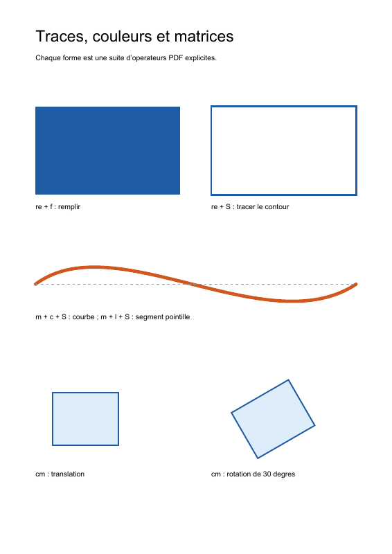

# 03. Tracés, couleurs et transformations

[Index des tutoriels](README.md) · [Précédent : pages et texte](02-pages-and-text.md) · [Suivant : plan du document](04-navigation.md)

Cette leçon dessine des rectangles, une courbe de Bézier et un segment pointillé. Elle applique ensuite une translation et une rotation au même rectangle local. Le script complet est [graphics.php](../../examples/graphics.php).

## Exécuter l'exemple

Utiliser PHP 8.3 ou supérieur et les dépendances installées par `composer install`. L'assemblage du document est celui du [premier tutoriel](01-first-document.md). Depuis la racine du dépôt :

```sh
php examples/graphics.php graphics.pdf
```

Le premier argument désigne la sortie. Sans argument, le fichier est `examples/graphics.pdf`. Son répertoire parent doit déjà exister.

## Ce que l'on obtient

Une page A4 avec deux rectangles bleus, l'un rempli et l'autre tracé ; une courbe orange et sa corde pointillée ; deux rectangles bleu clair en bas, dont l'un est tourné de 30 degrés. Les légendes restent noires et horizontales.



## 1. Construire un tracé, puis le peindre

Un tracé commence avec un point courant ou un rectangle. Les opérateurs de construction ajoutent sa géométrie ; un opérateur de peinture décide ensuite du rendu et termine ce tracé.

| Objet | Opérateur | Fonction |
| --- | --- | --- |
| `AppendRectangle` | `re` | Ajoute un rectangle avec `x`, `y`, largeur et hauteur. |
| `MoveTo` | `m` | Commence un sous-tracé en un point. |
| `LineTo` | `l` | Ajoute un segment depuis le point courant. |
| `CurveTo` | `c` | Ajoute une courbe avec deux points de contrôle et un point final. |
| `FillPathNonzero` | `f` | Remplit selon la règle nonzero winding. |
| `StrokePath` | `S` | Trace le contour. |
| `FillAndStrokePathNonzero` | `B` | Remplit et trace le contour. |

Le premier rectangle associe `re` et `f`, le second `re` et `S`. Le rectangle du bas utilise `B`. La courbe part de `(54, 410)`, utilise les points de contrôle `(175, 500)` et `(405, 320)`, puis arrive à `(541, 410)`. Les points de contrôle orientent la courbe sans devenir nécessairement des points qu'elle traverse.

Après `f`, `S` ou `B`, le tracé est terminé. Pour peindre à nouveau la même forme, il faut la reconstruire. Le validateur de `ContentStreams` refuse aussi de glisser un changement de couleur ou un `Q` au milieu d'un tracé inachevé : les réglages précèdent la géométrie, puis la peinture la termine.

Référence : ISO 32000-1, **8.5.2–8.5.3** pour la construction et la peinture des tracés.

## 2. Régler deux couleurs indépendantes

`SetNonstrokingRGBColor` (`rg`) choisit la couleur utilisée par les remplissages, et par le texte dans son mode de rendu par défaut. `SetStrokingRGBColor` (`RG`) choisit celle du contour. La casse des opérateurs PDF compte.

Les trois composantes DeviceRGB vont de 0 à 1. `SetLineWidth` (`w`) règle la largeur du contour. `SetLineCapStyle(LineCapStyle::Round)` (`J`) arrondit les extrémités de la courbe. `SetLineDashPattern` (`d`) reçoit un `LineDashPattern` : `[4 4]` alterne quatre unités peintes et quatre unités vides, avec une phase initiale de zéro.

Les couleurs DeviceRGB sont adaptées à cette démonstration ; leur rendu exact dépend du lecteur et du dispositif. Un besoin de gestion des couleurs demande un espace de couleur approprié, par exemple ICCBased, et ses ressources explicites.

Référence : **8.4.3–8.4.4** pour les paramètres d'état graphique, **8.6.4.3** et **8.6.8** pour DeviceRGB et les opérateurs de couleur.

## 3. Isoler un dessin avec q et Q

`SaveGraphicsState` (`q`) empile l'état graphique courant. `RestoreGraphicsState` (`Q`) restaure l'état sauvegardé : matrice de transformation, couleurs, largeur du trait et autres paramètres. Chaque forme du script est encadrée par cette paire.

Cet encadrement explique pourquoi les pointillés ne s'appliquent pas aux rectangles suivants et pourquoi leurs remplissages ne colorent pas les légendes. Il protège aussi les textes de la rotation appliquée à la dernière forme.

La géométrie du tracé courant ne fait pas partie de cet état sauvegardé. `Q` n'est donc pas une instruction permettant de terminer ou d'annuler un tracé. Le script peint chaque tracé avant de restaurer l'état, et équilibre toutes les paires `q`/`Q`.

Référence : **8.4.2** et **8.4.4**.

## 4. Dessiner dans un repère local

`ConcatenateMatrix` (`cm`) reçoit un `Matrix` de six `NumericType` : `[a b c d e f]`. Pour un point local `(x, y)`, la transformation de cet exemple donne :

```text
x' = a × x + c × y + e
y' = b × x + d × y + f
```

La page utilise ici les coordonnées habituelles, avec une unité égale à **1/72 de pouce** et l'origine en bas à gauche. Le rectangle local est centré en `(0, 0)` et mesure 100 × 80 unités ; sa construction commence donc en `(-50, -40)`.

- `[1 0 0 1 130 205]` place son centre en `(130, 205)` sans rotation.
- `[0.8660254 0.5 -0.5 0.8660254 415 205]` applique une rotation de 30 degrés, puis place son centre en `(415, 205)`. Les valeurs sont `cos(30°)` et `sin(30°)` arrondies.

`cm` **concatène** sa matrice à la matrice courante. Son résultat dépend donc de l'état déjà en place, et l'ordre de plusieurs transformations compte. Chaque exemple repart de l'état de la page grâce à `q` et `Q`. La rotation ne modifie pas `/Rotate` de la page : elle transforme seulement le dessin de ce bloc.

Référence : **8.3.2–8.3.3** pour les repères et matrices, **8.4.4** pour `cm`.

## À essayer

- Remplacer `StrokePath` par `FillAndStrokePathNonzero` pour ajouter un remplissage à un rectangle.
- Changer les deux points de contrôle de la courbe en gardant les points de début et de fin.
- Utiliser `[2 0 0 2 e f]` dans un bloc isolé : la taille du rectangle et sa largeur de contour sont transformées ensemble.
- Ajouter une deuxième paire `q`/`Q` dans un bloc pour expérimenter des états imbriqués.

Le placement et les marges sont explicites. Un tracé peut dépasser la page si ses coordonnées ou sa transformation le placent hors du papier ; vérifier le PDF après une modification des matrices.

[Index des tutoriels](README.md) · [Précédent : pages et texte](02-pages-and-text.md) · [Suivant : plan du document](04-navigation.md)
