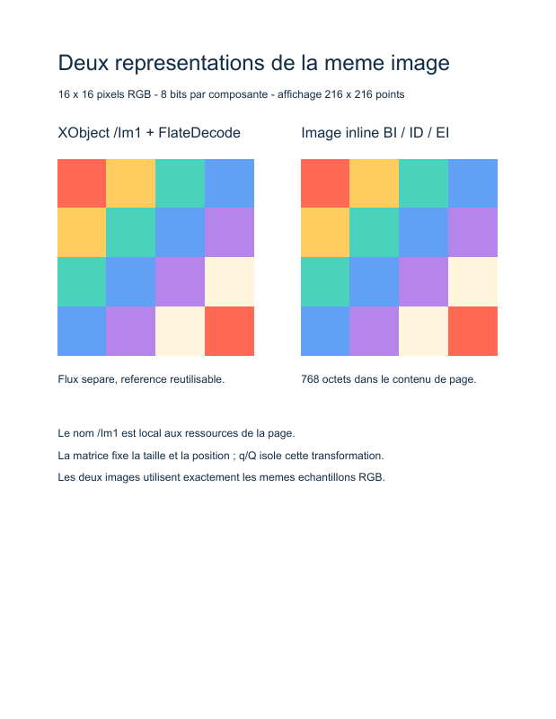

# 06. Deux représentations d'une image

Cet exemple affiche côte à côte le même motif coloré : à gauche un **XObject image** compressé et référencé par la page, à droite une **image inline** contenue dans les instructions de dessin. Le motif de 16 × 16 pixels est entièrement produit par PHP ; aucun fichier image ni téléchargement n'est nécessaire.



## Exécuter l'exemple

Depuis la racine du dépôt, après `composer install` :

```sh
php examples/images.php images.pdf
```

Le chemin de sortie est facultatif ; sa valeur par défaut est `examples/images.pdf`. Le script complet se trouve dans [examples/images.php](../../examples/images.php).

## 1. Produire les échantillons

`$pixels` contient des octets RGB bruts, rangés ligne par ligne. Chaque pixel occupe trois octets : rouge, vert et bleu. Avec 16 × 16 pixels et 8 bits par composante, le contenu mesure **768 octets**. La petite palette lumineuse et les blocs de quatre pixels rendent l'agrandissement facile à observer.

Ces données n'ont ni en-tête PNG ni en-tête JPEG. Le dictionnaire PDF fournit leur interprétation :

| Entrée | Objet PHP | Signification |
| --- | --- | --- |
| `/Width 16` | `WidthEntry(IntegerType)` | Nombre de pixels d'une ligne. |
| `/Height 16` | `HeightEntry(IntegerType)` | Nombre de lignes. |
| `/BitsPerComponent 8` | `BitsPerComponentEntry(IntegerType)` | Une composante tient dans un octet. |
| `/ColorSpace /DeviceRGB` | `ColorSpaceEntry(NameType)` | Chaque pixel comporte trois composantes. |
| `/Interpolate false` | `InterpolateEntry(BooleanType)` | Demande de conserver des contours nets à l'agrandissement. |

Ces classes d'entrées sont rattachées à la table 89 de la norme. Les mêmes objets d'entrées immuables servent aux deux représentations.

## 2. Construire un XObject image

`ImageDictionaryTable89` ajoute `/Type /XObject` et `/Subtype /Image` à la description des pixels. `StreamObject` associe ce dictionnaire aux données ; `FlateDecode` les compresse avec zlib lors de la sérialisation. Le flux écrit possède alors `/Filter /FlateDecode` et une `/Length` calculée sur les octets compressés.

Le nom du filtre décrit l'opération que le **lecteur PDF** applique pour retrouver les pixels. Le script fournit les pixels non compressés à `StreamObject`, qui effectue l'encodage correspondant.

```php
$image = new StreamObject($pixels, $imageDictionary, new FlateDecode());

new XObject(new DictionaryType(
    new Entry(new NameType('Im1'), new IndirectReference($image)),
));
```

Le dictionnaire `/Resources` de la page relie `/Im1` au flux indirect. `InvokeXObject(new NameType('Im1'))` produit `/Im1 Do`. Le même flux peut être invoqué plusieurs fois, avec des transformations différentes, sans recopier ses pixels.

## 3. Fixer la taille et la position

Les dimensions en pixels décrivent le contenu de l'image. L'image PDF est peinte dans le carré unité ; la matrice courante détermine sa taille sur la page.

```text
q
216 0 0 216 64 400 cm
/Im1 Do
Q
```

`ConcatenateMatrix` applique ici une mise à l'échelle de 216 × 216 points, puis une translation vers `(64, 400)`. Les 16 pixels sont donc agrandis. `SaveGraphicsState` (`q`) et `RestoreGraphicsState` (`Q`) encadrent la transformation pour que les autres dessins et textes conservent leurs coordonnées habituelles.

## 4. Insérer une image inline

`InlineImage` écrit une instruction composée de `BI`, du dictionnaire direct, de `ID`, des octets et de `EI`. Elle apparaît directement dans le flux de contenu, sans ressource `/Im1` ni objet image séparé.

L'exemple transmet les 768 octets bruts et ne déclare aucun filtre pour cette image. Son dictionnaire contient les dimensions, les bits, la couleur et l'interpolation ; les entrées `/Type` et `/Subtype` utilisées par le XObject sont absentes.

Une deuxième matrice la place à `(332, 400)` avec la même taille. Les deux motifs doivent donc avoir le même aspect, bien que leur organisation dans le fichier soit différente.

## À essayer

- Réutiliser `/Im1` avec un autre `InvokeXObject` et une autre matrice, pour comparer plusieurs tailles sans recréer le flux image.
- Passer `/Interpolate` à `true` et observer la décision d'interpolation du lecteur à fort agrandissement.
- Modifier la palette ou le motif tout en gardant exactement `Width × Height × 3` octets avec 8 bits par composante RGB.
- Remplacer les pixels par des données JPEG déjà encodées demanderait un autre filtre et une autre construction ; une chaîne de bytes PNG complète ne peut pas être utilisée comme pixels RGB bruts.

## Points à connaître

Cet exemple couvre des images opaques en `/DeviceRGB`, sans masque ni gestion de profils colorimétriques. Il ne fournit pas de chargeur PNG/JPEG. Les classes générées décrivent les entrées de la norme ; elles ne constituent pas un décodeur d'images.

Une image inline ne peut pas contenir une séquence binaire qui serait interprétée comme un terminateur `EI` ambigu. `InlineImage` refuse cette situation. La palette de ce tutoriel est choisie pour l'éviter ; un XObject image convient aux données arbitraires et aux images réutilisées.

Repères dans [ISO 32000-1:2008](../../PDF32000_2008.pdf) : **7.3.8** (flux), **7.4.4** (FlateDecode), **8.3.3** (transformations), **8.8** (XObjects), **8.9.5 et table 89** (dictionnaire image), **8.9.7** (images inline).

[← 5. Liens](05-links.md) · [Tous les tutoriels](README.md) · [7. Dégradé axial →](07-gradient.md)
