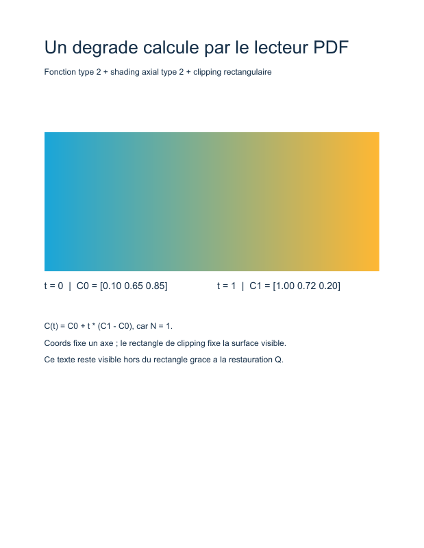

# 07. Un dégradé axial et une fonction PDF

Cet exemple crée un rectangle qui passe du bleu turquoise à l'orange. Le PDF contient une **fonction type 2**, un **shading axial type 2** et un chemin de clipping. Le lecteur calcule les couleurs du dégradé à partir de ces objets.



## Exécuter l'exemple

Depuis la racine du dépôt, après `composer install` :

```sh
php examples/gradient.php gradient.pdf
```

Le chemin de sortie est facultatif ; sa valeur par défaut est `examples/gradient.pdf`. Voir le script complet [examples/gradient.php](../../examples/gradient.php).

## 1. Définir la couleur comme une fonction

`ExponentialInterpolationFunction` représente la fonction PDF type 2. Elle reçoit un nombre `t` et renvoie ici trois nombres, les composantes RGB d'une couleur :

```text
C(t) = C0 + t^N × (C1 − C0)
```

`Domain` contient l'intervalle d'entrée `[0, 1]`. `C0 = [0.10, 0.65, 0.85]` donne le turquoise au début ; `C1 = [1.00, 0.72, 0.20]` donne l'orange à la fin. L'exposant `N` vaut `1`, ce qui produit une interpolation linéaire. À `t = 0.5`, la couleur est la moyenne des deux couleurs.

`Range` contient trois intervalles `[0, 1]`, un par composante de sortie. Le même objet immuable `NumberInterval` est réutilisé pour ces intervalles. `NumberArray` rassemble les composantes en conservant chacune comme objet numérique.

Le type de la **fonction** décrit le calcul. Le type du **shading**, également numéroté `2` ici, décrit comment répartir les paramètres de ce calcul dans l'espace de la page.

## 2. Construire le shading axial

Le dictionnaire `Type2ShadingDictionaryTable80` reçoit les entrées communes de la table 78 et les entrées propres au shading axial de la table 80 :

| Entrée | Valeur de l'exemple | Rôle |
| --- | --- | --- |
| `/ShadingType` | `2` | Choisit le shading axial. |
| `/ColorSpace` | `/DeviceRGB` | Les trois sorties de la fonction sont des composantes RGB. |
| `/Coords` | `[64 500 548 500]` | Relie le point de départ `(64, 500)` au point d'arrivée `(548, 500)`. |
| `/Domain` | `[0 1]` | Associe ces points à `t=0` et `t=1`. |
| `/Function` | Référence indirecte à `$function` | Calcule la couleur pour chaque paramètre. |
| `/Extend` | `[false false]` | Demande de ne pas étendre les couleurs au-delà des extrémités de l'axe. |

L'axe est horizontal. Le paramètre `t` varie le long de cet axe ; la couleur reste constante perpendiculairement à lui. `/Coords` ne définit donc pas à lui seul un rectangle.

Les classes `ShadingTypeEntry` et `ColorSpaceEntry` portent la provenance de la table 78. `CoordsEntry`, `DomainEntry`, `FunctionEntry` et `ExtendEntry` proviennent de la table 80. Cette composition exprime les deux parties du dictionnaire décrit par la norme.

## 3. Nommer la ressource

Le dictionnaire `/Shading` des ressources de la page associe `/Sh1` à une référence indirecte vers le dictionnaire de shading. `PaintShading(new NameType('Sh1'))` produit `/Sh1 sh` et retrouve cette ressource locale.

Le graphe contient deux objets indirects distincts : le shading et la fonction qu'il référence. Le writer attribue leurs numéros en parcourant ce graphe ; le script n'écrit aucun numéro d'objet à la main.

## 4. Limiter la surface peinte

Le flux de contenu encadre le dégradé par ces instructions :

```text
q
64 400 484 200 re
W
n
/Sh1 sh
Q
```

1. `q` sauvegarde l'état graphique, y compris le clipping courant.
2. `re` crée le chemin d'un rectangle à `(64, 400)`, de largeur `484` et de hauteur `200` points.
3. `W` demande que ce chemin serve de clipping selon la règle nonzero.
4. `n` termine le chemin sans le peindre et applique le clipping demandé.
5. `sh` peint le shading dans cette zone.
6. `Q` restaure l'état graphique antérieur.

Le clipping donne au dégradé sa forme rectangulaire. La restauration permet d'écrire les explications en dessous, hors du rectangle : elles seraient masquées si le clipping restait actif.

## À essayer

- Passer `N` de `1` à `2` : l'axe et les couleurs finales restent les mêmes, mais l'orange arrive plus progressivement.
- Placer les extrémités de `/Coords` verticalement pour changer la direction de variation.
- Modifier le rectangle de clipping tout en conservant `/Coords` pour distinguer la géométrie du paramétrage des couleurs.
- Réduire la longueur de l'axe et comparer `/Extend [false false]` à `[true true]` dans le même rectangle.

## Points à connaître

Le script traite un shading axial en `/DeviceRGB`, avec une fonction à une entrée et trois sorties. Il n'aborde pas les shadings radiaux, les maillages, la transparence ni les profils ICC.

Les classes d'entrées vérifient les types décrits par les tables. La construction de l'exemple respecte aussi les liens sémantiques : quatre coordonnées, trois sorties de fonction pour RGB, domaine compatible et deux booléens d'extension. Les classes générées ne garantissent pas à elles seules toutes ces relations pour un assemblage arbitraire.

Repères dans [ISO 32000-1:2008](../../PDF32000_2008.pdf) : **7.10.3 et table 40** (fonction type 2), **8.4.2** (état graphique), **8.5.4** (clipping), **8.7.4.3 et table 78** (shading et `sh`), **8.7.4.5.3 et table 80** (shading axial).

[← 6. Images](06-images.md) · [Tous les tutoriels](README.md) · [8. Flux d'objets →](08-object-stream.md)
